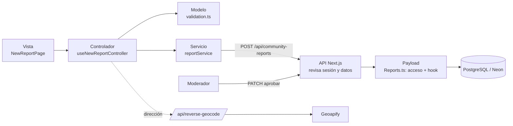

# Documento de arquitectura y decisiones técnicas — Ruta Segura

**Equipo:** [COMPLETAR] · **Repositorio:** https://github.com/valebasic/Ruta_Segura · **Fecha:** [COMPLETAR]

> Todo lo que aquí se afirma sale del código del proyecto. Lo que no se pudo comprobar en el código está marcado con **[VERIFICAR]**. Las partes 1 a 6 son el documento de máximo 5 páginas (Art. 9); la parte 7 (glosario) y la 8 (preguntas del jurado) son material de apoyo para la sustentación y no hace falta entregarlas.

---

## 1. Resumen de la solución

**Problema.** En Facatativá y municipios cercanos no hay un lugar donde la gente comparta, de forma sencilla y segura, dónde se siente en riesgo al moverse (calles con acoso, mala iluminación o zonas solas). Sin esa información, cada persona decide su ruta sin saber lo que otras ya vivieron.

**ODS.** El código no nombra ningún ODS. Los que encajan con lo que hace la app son el **ODS 11** (ciudades y comunidades sostenibles, espacios públicos seguros), el **ODS 5** (igualdad de género, porque una de las categorías es el acoso) y el **ODS 16** (participación e instituciones). **[VERIFICAR]** cuáles declaró el equipo en la inscripción.

**Usuarios.** Tres roles reales en el código:
- **Comunidad** (`users`, rol `community`): se registra, crea reportes y ve los aprobados y los propios.
- **Moderador** (`users`, rol `moderator`): aprueba, rechaza u oculta reportes.
- **Administrador** (`admins`): entra al panel `/admin` de Payload; no se pueden crear desde la app.

**Funciones principales.**
1. Registro, inicio y cierre de sesión, y eliminación de cuenta con contraseña.
2. Crear un reporte: municipio, punto de referencia, categoría (ACOSO, ILUMINACIÓN DEFICIENTE, ZONA DESOLADA), descripción de 10 a 280 caracteres y ubicación por GPS o tocando el mapa. La dirección aproximada se obtiene sola.
3. Ver reportes aprobados en lista y en mapa, con filtros por municipio y categoría.
4. Moderación: los reportes nacen "pendientes" y solo se publican cuando un moderador los aprueba.
5. Aviso permanente: es percepción comunitaria, no un servicio de emergencia (`Display.tsx`).

---

## 2. Stack tecnológico y por qué

| Tecnología | Qué es y para qué se usó aquí | Por qué la elegimos | Alternativas y desventajas |
|---|---|---|---|
| **TypeScript sobre Node.js** (Node ≥ 24, `package.json`) | Un solo lenguaje para servidor y pantalla. Node ejecuta el servidor. | Con poco tiempo, un solo lenguaje evita escribir y mantener dos proyectos; los tipos detectan errores antes de ejecutar. | Python/Django: el equipo lo tuvo al inicio y lo retiró (ver `Documento_uso_IA.md`). Desventaja de TypeScript: curva de aprendizaje y más configuración. |
| **Next.js 16 + React 19** | Next.js sirve la app y las rutas de API (`src/app/(frontend)/api/*`). React construye las pantallas. | Front y API en el mismo proyecto y el mismo despliegue; React permite pantallas por componentes. | Express + React por separado: más piezas que desplegar. Desventaja: Next.js cambia rápido y es una versión nueva con poca documentación. |
| **Tailwind CSS 4** | Estilos con clases directamente en el HTML. | Diseño consistente y rápido sin escribir CSS aparte. | CSS propio o Bootstrap. Desventaja: las clases largas hacen el código más denso. |
| **Payload CMS 4 (beta)** | Capa de datos: define las tablas (colecciones), el login, los permisos y un panel de administración listo. | Nos dio login, roles, panel `/admin` y validaciones sin construirlos desde cero. | Prisma + Express o Supabase: más código propio. **Desventaja importante:** la versión es *beta* (`4.0.0-beta.4`); puede haber cambios y errores. |
| **PostgreSQL** (`@payloadcms/db-postgres`) alojada en **Neon** | Base de datos relacional. Neon es PostgreSQL en la nube. | Los datos tienen relaciones claras (reporte → municipio, categoría, dueño) y reglas de integridad; es el tipo de datos "tabla". Neon tiene capa gratuita. | MongoDB: flexible pero sin relaciones fuertes. Supabase: es PostgreSQL con extras que no necesitábamos. Desventaja: la capa gratuita tiene límites de uso y de almacenamiento **[VERIFICAR el plan contratado]**. |
| **Autenticación de Payload (JWT en cookie)** | Cuentas, contraseñas y sesión. Ver sección 4. | Es el sistema ya probado de Payload; no escribimos criptografía propia. | OAuth/Google o NextAuth: más complejo y dependiente de terceros; no se implementó. Desventaja: solo correo y contraseña, sin recuperar contraseña (se retiró). |
| **Leaflet + OpenStreetMap** | Mapa interactivo (`LeafletMap.tsx`); los mapas vienen de `tile.openstreetmap.org`. | Libre y gratuito, sin tarjeta ni clave. | Google Maps: de pago y con clave. Desventaja: los servidores públicos de OSM no están pensados para mucho tráfico. |
| **Geoapify** (API externa) | Convierte coordenadas en dirección (`/api/reverse-geocode`). Es la única API externa de datos. | Ahorra a la persona escribir la dirección. La clave `GEOAPIFY_API_KEY` vive solo en el servidor. | Nominatim (OSM): sin clave pero con límites estrictos. Desventaja: dependemos de un tercero; si falla, el reporte igual se envía con coordenadas. |
| **Despliegue** | `output: 'standalone'` en `next.config.ts` y scripts `.figma/make/deploy`. Código en GitHub. | Plantilla de Figma Make con Next.js y Payload ya preparada. | **[VERIFICAR]** dónde está publicada la app hoy (Figma Make u otro servicio): el código solo muestra que está preparada para Figma Make y que la base está en Neon. |

No se usó: datos abiertos oficiales, OAuth, correo electrónico (Resend se probó y se retiró), ni Redis o cachés.

---

## 3. Arquitectura

**Patrón: MVC por capas** (Modelo–Vista–Controlador), más una capa de **servicios** y el **servidor/API**.

| Capa | Carpeta | Qué hace | Ejemplo real |
|---|---|---|---|
| **Modelo** | `src/models/` y `src/collections/` | Datos, tipos y reglas | `validation.ts` valida el formulario; `Reports.ts` define la tabla de reportes y quién puede leer o escribir. |
| **Vista** | `src/views/` | Lo que se ve; no decide nada | `NewReportPage.tsx` pinta el formulario y recibe todo del controlador. |
| **Controlador** | `src/controllers/` | Lógica de cada pantalla (hooks de React) | `useNewReportController.ts` guarda lo que escribe la persona, valida, pide la dirección y envía el reporte. |
| **Servicios** | `src/services/` | Hablan con el servidor | `reportService.ts` hace `fetch` a `/api/community-reports`. |
| **API / servidor** | `src/app/(frontend)/api/` | Reciben la petición, revisan sesión y datos, guardan | `community-reports/route.ts`. |

Detalle honesto: la parte "controlador" del lado del navegador son hooks de React, y la API de Next.js hace de controlador del lado del servidor. La carpeta `src/app/(payload)/` es del propio Payload y no se modificó.

**Estructura de carpetas**
```
src/
 ├─ models/        tipos, constantes, validación
 ├─ views/         App.tsx, pages/, components/
 ├─ controllers/   useSession / useReports / useNewReport / useModeration / useAuth / useProfile
 ├─ services/      authService, reportService, geoService
 ├─ collections/   Users, Admins, Reports, Municipalities, RiskCategories, Media...
 ├─ lib/           app-auth.ts (sesión por cookie)
 ├─ payload.config.ts
 └─ app/(frontend)/api/   app-auth/*, community-reports, moderation-reports, taxonomies, reverse-geocode
```

**Flujo de punta a punta: crear un reporte**
1. La persona llena `NewReportPage` (vista) → 2. `useNewReportController` valida con `validateNewReport` (modelo) → 3. `reportService.submitReport` envía `POST /api/community-reports` → 4. La ruta lee la cookie de sesión (`getCurrentAppUser`); si no hay, responde 401 → 5. Revisa de nuevo todos los campos y que municipio y categoría existan → 6. `payload.create` con `overrideAccess: false`: Payload aplica las reglas de `Reports.ts` y un hook fija `owner` = usuario de la sesión y `status` = `pending` → 7. Se guarda en PostgreSQL → 8. Respuesta 201 y la vista muestra "enviado" → 9. Un moderador lo ve en `/api/moderation-reports` y lo aprueba con `PATCH` → 10. Solo entonces aparece en el mapa y la lista pública.



---

## 4. Seguridad (OWASP Top 10 y manejo de secretos)

| Riesgo OWASP | Cómo se cubrió (con evidencia) | Pendiente o límite |
|---|---|---|
| **A01 Control de acceso roto** | Reglas por colección en `Reports.ts` y `Users.ts`: el público solo lee reportes `approved`; la persona ve los suyos; solo moderador/admin actualiza o borra. Los campos `status`, `owner` y `role` tienen permiso por campo, así que nadie puede subirse de rol ni auto-aprobarse. Las rutas de moderación revisan `role === 'moderator'` (403). Las llamadas usan `overrideAccess: false`. | `delete-account` usa `overrideAccess: true` a propósito, pero solo después de revalidar la contraseña. |
| **A02 Fallas criptográficas** | Contraseñas: las gestiona Payload, que guarda un resumen con sal (*hash*), nunca el texto **[VERIFICAR en la documentación de Payload 4 beta]**. Cookie de sesión `httpOnly`, `sameSite: lax` y `secure` en producción. La conexión a Neon es cifrada (según `Documento_uso_IA.md`) **[VERIFICAR `sslmode` en la URL real]**. | — |
| **A03 Inyección** | No hay SQL escrito a mano: se usa la API de Payload (consultas parametrizadas). Los datos se validan en el servidor (rangos de coordenadas, longitud, listas permitidas). React escapa el texto al mostrarlo. | — |
| **A04 Diseño inseguro** | Los reportes quedan en moderación antes de publicarse; categorías fijas; el público no ve quién reportó (la API pública no devuelve `owner`). | No hay análisis formal de amenazas. |
| **A05 Configuración insegura** | `.env*` está en `.gitignore`. Mensajes de error genéricos. | Faltan cabeceras de seguridad (CSP, etc.) en `next.config.ts`. `typescript.ignoreBuildErrors: true` oculta errores de tipos en el build. El plugin `mcpPlugin` está activo en `payload.config.ts`: **[VERIFICAR]** qué expone en producción. |
| **A06 Componentes vulnerables** | Dependencias fijadas en `pnpm`. | Varias piezas son *beta*; no hay auditoría automática (`pnpm audit`) en el repo. |
| **A07 Fallas de autenticación** | Mínimo 8 caracteres, mensaje igual para correo o contraseña errónea ("Credenciales inválidas", 401), eliminar cuenta exige la contraseña. Payload bloquea tras varios intentos fallidos por defecto **[VERIFICAR]**. | Sin segundo factor ni recuperación de contraseña. La política de contraseña es solo de longitud. |
| **A08 Integridad de datos** | Revalidación en el servidor aunque el navegador ya validó; el dueño y el estado los fija el servidor, no el formulario. | — |
| **A09 Registro y monitoreo** | Solo los registros por defecto del servidor. | No hay auditoría de acciones de moderación ni alertas. |
| **A10 SSRF** | La única llamada saliente es a Geoapify con URL fija; solo se envían números `lat` y `lon` validados. | `/api/reverse-geocode` no exige sesión ni limita frecuencia: alguien podría gastar la cuota de la clave. |

**Secretos.** `DATABASE_URL`, `PAYLOAD_SECRET` y `GEOAPIFY_API_KEY` se leen de variables de entorno en código de servidor; ninguna está en el repositorio ni en `NEXT_PUBLIC_*`. Las claves de Neon y Resend se compartieron en el chat de trabajo, por lo que **deben rotarse** (lo recomienda `Documento_uso_IA.md`).

**Datos sensibles.** Se guarda correo, nombre, contraseña (resumen) y la ubicación de cada reporte. El reporte se asocia a su autor internamente, pero no se muestra. Quien elimina su cuenta borra también sus reportes. **[VERIFICAR]** si existe política de tratamiento de datos (Ley 1581 de 2012) publicada en la app: en el código no aparece.

---

## 5. UX y accesibilidad

**Lo que sí está en el código**
- Idioma de la página `es` (`<html lang>`), panel de administración en español.
- Botones de al menos 44 px de alto (`min-h-11`) y campos de 48 px (`min-h-12`); anillo de foco visible (`focus-visible`, `focus:ring`).
- Etiquetas accesibles en botones con ícono (`aria-label`), íconos decorativos ocultos (`aria-hidden`), mapa con `aria-label`, errores del perfil con `role="alert"`.
- Mensajes de error por campo en el formulario, textos cortos y en lenguaje cotidiano; opción manual cuando el GPS falla.
- Aviso de que la información es percepción y no emergencia; texto "tu reporte es anónimo para la comunidad".
- Diseño pensado para celular: barra de navegación inferior (`BottomNav`) y mapa lazy (`LeafletMapLazy`) para cargar más rápido.

**Lo que NO se puede afirmar con el código**
- Cumplimiento **WCAG 2.1 AA**: no hay auditoría ni medición de contraste, y el mapa de Leaflet no se maneja bien solo con teclado. Decir "cumple AA" sería inexacto; lo honesto es "se aplicaron prácticas de AA". **[VERIFICAR]** si se pasó una herramienta (Lighthouse, axe).
- **Onboarding y ayuda contextual**: no hay tutorial de primer uso ni tooltips; lo más cercano es el texto de bienvenida en `AuthPage` y las leyendas del formulario.
- **Prueba de usabilidad**: no hay evidencia en el repositorio. Solo consta que el equipo probó la app en el navegador y reportó fallos con capturas. **[COMPLETAR]** número de participantes, tareas y resultados reales; no se deben inventar.

---

## 6. Escalabilidad y sostenibilidad

**Cómo crecería.** Next.js es sin estado (la sesión va en el token), por lo que se pueden añadir más instancias. La base está en PostgreSQL gestionado (Neon), que escala por plan. Agregar un municipio o categoría nueva se hace desde datos (colecciones), sin tocar la lógica; los índices ya están en `municipality`, `category`, `status` y `owner`.

**Límites hoy (honestos)**
- La lista pública devuelve máximo **100** reportes, ordenados por fecha, sin paginación ni filtro por zona en el servidor: con muchos datos hay que paginar o agrupar por mapa.
- Los puntos de referencia por municipio están escritos en `models/constants.ts` (fijos en el código); la validación en el servidor solo comprueba que no esté vacío.
- No hay límite de peticiones (*rate limit*), ni caché, ni pruebas automáticas **[VERIFICAR: no se encontraron]**.
- Un solo moderador con la cola completa no escala; faltan notificaciones.
- Dependencia de versiones beta y de dos servicios gratuitos (OpenStreetMap, Geoapify, Neon) con cuotas.

**Sostenibilidad.** Tecnologías abiertas y gratuitas, código ordenado por capas que otro equipo puede mantener, y bajo costo de operación. **[VERIFICAR]** si existe un plan de quién modera después del concurso.

---

# Material de apoyo para la sustentación (fuera del límite de 5 páginas)

## 7. Glosario simple

- **MVC:** forma de ordenar el código en tres partes: *Modelo* (datos y reglas), *Vista* (lo que se ve) y *Controlador* (conecta las dos).
- **API:** puerta por la que el navegador le pide cosas al servidor.
- **REST:** estilo de API con direcciones y verbos: `GET` pedir, `POST` crear, `PATCH` cambiar, `DELETE` borrar.
- **JSON:** formato de texto para enviar datos entre navegador y servidor.
- **JWT:** "pase" firmado que identifica a la persona después de iniciar sesión; el servidor comprueba la firma.
- **Cookie `httpOnly`:** donde se guarda el pase; el código del navegador no puede leerla, lo que dificulta robarla.
- **Hash (resumen) y sal:** forma de guardar contraseñas sin guardar la contraseña; la sal evita que dos iguales den el mismo resultado.
- **Rol:** permisos según el tipo de usuario (comunidad, moderador, administrador).
- **Autenticación / Autorización:** saber *quién eres* / saber *qué puedes hacer*.
- **ORM:** herramienta que permite hablar con la base de datos usando código en vez de SQL. Aquí cumple esa función la API de Payload (no usamos un ORM como Prisma).
- **Base relacional (PostgreSQL):** datos en tablas conectadas entre sí.
- **SQL:** lenguaje para consultar bases relacionales.
- **CMS (Payload):** sistema que define los datos y da un panel para administrarlos.
- **Colección:** una "tabla" en Payload (reportes, usuarios...).
- **Hook:** pequeña función que se ejecuta automáticamente en un momento (aquí, antes de guardar un reporte).
- **Next.js / React:** herramienta para armar la web / librería para construir pantallas con componentes.
- **Componente:** pieza reutilizable de pantalla (un botón, una tarjeta).
- **Hook de React:** función que da memoria y comportamiento a un componente; aquí hacen de controladores.
- **TypeScript:** JavaScript con tipos, para detectar errores antes de ejecutar.
- **Variable de entorno:** dato secreto o de configuración guardado fuera del código.
- **Geocodificación inversa:** de coordenadas a una dirección.
- **Moderación:** revisión humana antes de publicar.
- **Beta:** versión aún en pruebas.
- **OWASP Top 10:** lista de los 10 riesgos de seguridad web más comunes.
- **WCAG 2.1 AA:** guía internacional de accesibilidad web, nivel intermedio.
- **ODS:** Objetivos de Desarrollo Sostenible de la ONU.
- **Escalabilidad:** capacidad de atender más usuarios sin rehacer todo.
- **Rate limit:** tope de peticiones por persona para evitar abusos.

## 8. Diez preguntas probables del jurado

1. **¿Por qué Next.js con Payload y no un backend aparte?** Una sola base de código y despliegue; Payload ya trae login, permisos y panel. Costo: es una versión beta.
2. **¿Por qué PostgreSQL y no MongoDB?** Los datos son relacionales (reporte–municipio–categoría–dueño) y necesitan integridad; las tablas lo garantizan.
3. **¿Cómo protegen las contraseñas?** No se guardan: Payload guarda un resumen con sal. Mínimo 8 caracteres y la sesión va en cookie `httpOnly`. [VERIFICAR detalle del algoritmo.]
4. **¿Cómo evitan que alguien se vuelva moderador o apruebe sus propios reportes?** Los campos `role`, `status` y `owner` tienen permiso por campo: solo moderador/admin los escribe, y el servidor fija dueño y estado "pendiente".
5. **¿Qué datos personales guardan y cómo cuidan la privacidad?** Correo, nombre y ubicación del reporte. Los reportes se muestran sin autor y la persona puede eliminar su cuenta y sus reportes. Falta publicar la política de datos. [VERIFICAR]
6. **¿Qué API externa usan y qué pasa si falla?** Geoapify para la dirección y OpenStreetMap para el mapa. Si Geoapify falla, se envía igual con coordenadas.
7. **¿Realmente aplican MVC?** Sí, por carpetas: modelos y colecciones, vistas, controladores (hooks) y servicios. Reconocemos que en Next.js la API del servidor también hace de controlador.
8. **¿Cumple WCAG 2.1 AA?** Aplicamos prácticas (foco visible, tamaños táctiles, etiquetas, idioma), pero no hicimos auditoría formal; es una mejora pendiente.
9. **¿Qué pasa si hay 100.000 reportes?** La lista hoy trae máximo 100 y sin paginación. El siguiente paso es paginar, agrupar puntos en el mapa, poner caché y límite de peticiones.
10. **¿Cómo evitan falsos reportes o abuso?** Moderación humana previa, categorías fijas, límite de 280 caracteres y cuenta obligatoria. Falta límite de frecuencia y herramientas contra spam.

*Dato extra por si preguntan por IA:* el uso de Claude Code está declarado en `Documento_uso_IA.md`.
